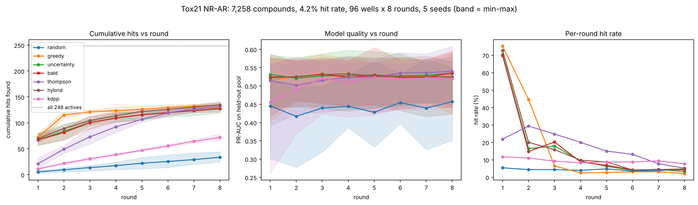
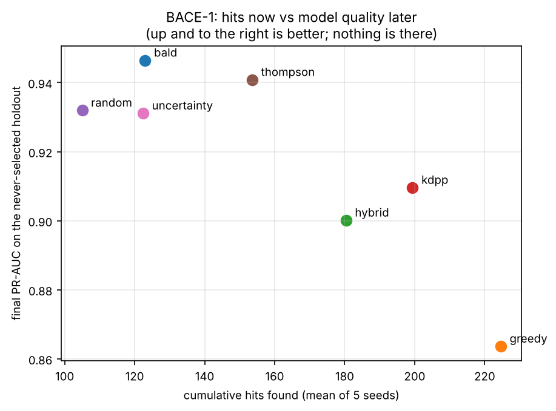
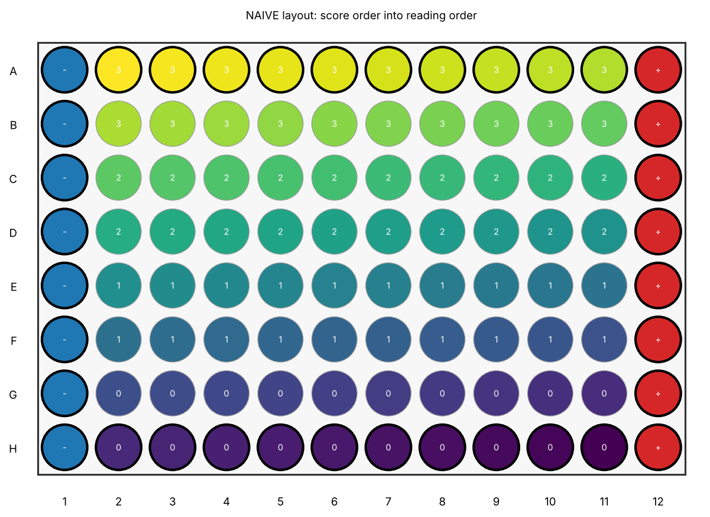
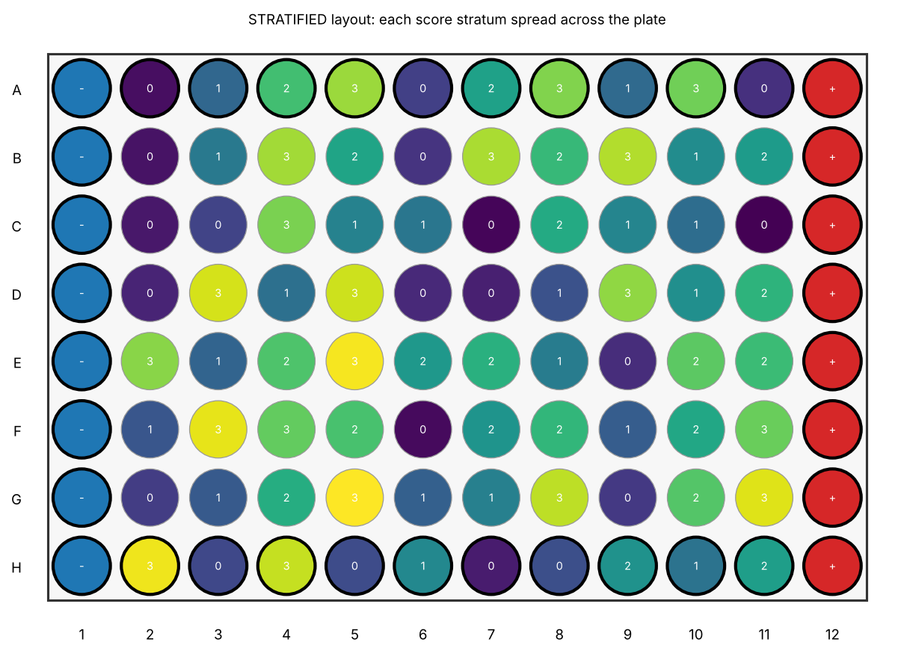

# Loopwise

**Active-learning experiment selection for small-n biological assays.**

A lab has a model, a candidate pool of thousands, and room for 96 wells. The
default is greedy: test the 96 highest predictions. Greedy maximizes this
round's hit rate and minimizes what the model learns, so the campaign
plateaus. Loopwise implements and compares selection policies that trade
exploitation against information gain, and makes the trade-off explicit and
auditable.

```python
from loopwise import Campaign

c = Campaign(pool=df, model=estimator, budget=96, policy="bald")
batch = c.select()           # the chosen rows + why each was chosen
c.observe(results_df)        # feed measurements back
c.report()                   # regret curve, calibration drift, diversity
```

---

## The argument, and what the evidence actually says

The pitch for active learning is that greedy selection is short-sighted:
measuring what you already believe teaches you nothing, so your model stops
improving and your hit rate collapses. We tested that on real screening data
rather than asserting it. **The plateau is real. The conclusion people usually
draw from it is not.**

### The headline figure



*Tox21 NR-AR: 7,258 compounds, 4.2% hit rate, 96 wells x 8 rounds, 5 seeds.
Bands are the min-max envelope across seeds — a gap smaller than the bands is
not a result. Model quality (middle panel) is PR-AUC on a fixed 20% holdout
that no policy could select.*

In that run, hybrid and greedy finish in a dead heat (134.8 ± 5.0 against
134.2 ± 3.6 cumulative hits), the information-seeking policies trail slightly
(bald 127.8, uncertainty 126.8), and every model-driven policy lands within
noise of the others on model quality. Random finds 33.6. The right-hand panel
is where the interesting thing happens, so we ran it for longer.

### What we found

Over 30 rounds of 32 wells on Tox21 NR-AR (5 seeds, mean values):

| Round | 1 | 4 | 7 | 10 | 13 | 19 | 25 | 30 |
| --- | --- | --- | --- | --- | --- | --- | --- | --- |
| **greedy** hit rate | 24% | **71%** | 41% | 11% | 6% | 4% | 3% | 4% |
| **thompson** hit rate | 9% | 28% | 26% | 22% | 18% | 11% | 6% | 6% |
| **k-DPP** hit rate | 11% | 13% | 15% | 16% | 13% | 14% | 10% | 10% |

**The plateau is exactly as advertised.** Greedy peaks at a 71% hit rate in
round 4 and falls to 1–4% by round 13. It has consumed a chemotype: the model
knew one region of chemical space, that region has finitely many members, and
every well spent there confirmed what the model already believed. From round 9
onward, greedy is the *least* productive model-driven policy, and stays that
way for the remaining 21 rounds.

**But the cumulative crossover never happens.** Greedy's early lead is so large
that after 30 rounds it is still nominally ahead:

| Policy | Cumulative hits (± SD over 5 seeds) | Final PR-AUC |
| --- | --- | --- |
| greedy | **145 ± 6.0** | 0.525 ± 0.047 |
| hybrid | 142.6 ± 5.5 | 0.530 ± 0.063 |
| thompson | 142.2 ± 5.6 | 0.534 ± 0.043 |
| bald | 136.8 ± 4.3 | 0.533 ± 0.058 |
| uncertainty | 134.2 ± 3.6 | 0.532 ± 0.059 |
| k-DPP | 112.2 ± 7.3 | 0.534 ± 0.064 |
| random | 40.4 ± 4.6 | 0.478 ± 0.076 |

Hybrid and Thompson converge to a statistical tie with greedy — the gaps are
well inside the seed-to-seed spread — while being far better behaved late.
Nothing overtakes it. **If someone tells you active learning reliably beats
greedy on hit count, ask for their replay.**

Two further results that are easy to miss and matter more than the ranking:

1. **The largest single effect is "use the model at all."** Random finds 40
   hits where every model-driven policy finds 112–145. Everything after that is
   a second-order choice.
2. **Final model quality is flat across all model-driven policies** (0.525–0.534,
   against a seed SD of ~0.05). On *this* dataset, the information-seeking
   policies did not buy a better model.

### Where the trade-off does show up

On the BACE-1 dose-response set (1,513 compounds, 24 wells x 10 rounds, 5
seeds), the two objectives come apart cleanly:

| Policy | Cumulative hits (± SD) | Final PR-AUC (± SD) |
| --- | --- | --- |
| greedy | **224.6 ± 7.4** | **0.864 ± 0.033** (worst) |
| kdpp | 199.4 ± 2.5 | 0.910 ± 0.035 |
| hybrid | 180.4 ± 9.5 | 0.900 ± 0.036 |
| thompson | 153.6 ± 2.5 | 0.941 ± 0.028 |
| bald | 123.0 ± 4.2 | **0.946 ± 0.013** (best) |
| uncertainty | 122.4 ± 5.6 | 0.931 ± 0.019 |
| random | 105.0 ± 3.7 | 0.932 ± 0.032 |



A clean Pareto front, and unlike the Tox21 numbers these gaps are several times
the seed spread. Greedy finds 83% more hits than BALD **and ends with the worst
model of any policy — worse than random selection.** If your campaign's
deliverable is a shortlist of actives, that is a good trade. If the deliverable
is a model you intend to use on the next target, greedy is destroying the thing
you are paying for.

That is the honest summary: *which* policy wins depends on the hit rate, the
budget-to-pool ratio, the horizon, and which deliverable you are actually
buying. Loopwise exists to let you measure that for your own data instead of
guessing — the full comparison is in
[`cookbook/02_replay_public_screen.ipynb`](cookbook/02_replay_public_screen.ipynb),
executed with outputs committed.

---

## Install

```bash
pip install -e .                 # core
pip install -e ".[all]"          # + LightGBM, PyTorch, RDKit, notebooks, dev
conda env create -f environment.yml   # if you want RDKit the easy way
```

Core requirements: numpy, pandas, scipy, scikit-learn, matplotlib, psutil.

## Quick start

```python
import pandas as pd
from sklearn.ensemble import RandomForestClassifier
from loopwise import Campaign

pool = pd.read_csv("candidates.csv")   # id + numeric feature columns

c = Campaign(
    pool=pool,
    model=RandomForestClassifier(n_estimators=200),
    budget=96,                      # wells per round
    policy="hybrid",
    feature_cols=[f"fp_{i}" for i in range(512)],
    id_col="compound_id",
    n_rounds_planned=6,             # the hybrid schedule needs to know
)

batch = c.select()
print(batch.explain())
batch.to_csv("round1_batch.csv")
batch.save_plate_map("plate_map.csv", "plate_map.png")

# ... run the assay, then:
c.observe(pd.read_csv("round1_results.csv"))
print(c.report().summary())
```

Round 1 will tell you it used the *seeding* policy. With no measurements there
is no model to exploit and no uncertainty to explore, so the only sensible
objective is to cover the feature space. Loopwise does that and says so, rather
than fitting a model to nothing.

Every selected row carries its reason:

```
rank 7/96 by 0.53*exploit + 0.47*bald (exploit 0.981, explore 0.642 -> 0.822);
round 2 of 6
```

From the command line:

```bash
loopwise select pool.csv --policy hybrid --budget 96 --plate 96 --out round1/
loopwise replay tox21 --n-seeds 5        # reproduce the headline comparison
loopwise check                           # what this machine can handle
```

---

## Which policy should I use?

| Your situation | Policy | Why |
| --- | --- | --- |
| One round, then done | `greedy` | Nothing to learn for. It is the right answer, not a straw man. |
| Many rounds, need hits throughout | `hybrid` *(default)* | Matches greedy's total while staying productive late. |
| No knobs, long campaign | `thompson` | Self-tuning exploration; the most stable per-round rate we measured. |
| The model is the deliverable | `bald` or `uncertainty` | On BACE, BALD's model beat greedy's by 8 PR-AUC points. |
| Round 1, no model yet | `diversity`, `quality_weight=0` | Automatic. Space-filling is the only sensible blind objective. |
| Library is full of analogue series | `hybrid(explore="diversity:kdpp")` | Stops you buying one measurement 96 times. |
| Noisy assay | `bald` over `uncertainty` | BALD ignores irreducible noise; uncertainty sampling chases it. |
| Finding out whether any of this helps | `random` + `greedy` | The two reference lines. Never omit `random`. |

Full detail, including how each one fails: [`docs/policies.md`](docs/policies.md).

**The hybrid schedule is a funding decision, not a statistical one.**
Information acquired early compounds over the remaining rounds, so the default
anneals `alpha` from 0.4 to 0.9 — explore first, harvest later. But a lab whose
round 1 returns no actives may not get a round 2. If you need hits now to keep
the project alive, invert it (`alpha_start=0.8, alpha_end=0.3`) and buy
political survival with a worse final model. Both are supported deliberately,
and the alpha used in each round is recorded in the batch output, so the
trade-off stays auditable after the fact.

---

## Batch realism

Selection is the easy half. These are the parts that decide whether the batch
is runnable.

### Plate layout and edge effects

A plate's outer ring evaporates faster, equilibrates differently, and exchanges
gas differently; the bias is typically 5–20% of signal and is systematic, so
replicates do not average it away. Now fill a plate row-wise with a
score-ordered batch:

| Naive: score order into reading order | Stratified: Loopwise's layout |
| --- | --- |
|  |  |

In the left plate, every top-quartile compound is in rows A and B. **Row A is
an edge row.** The edge bias is now perfectly correlated with the model's
prediction: if it is positive you "confirm" your model and chase an artifact
for six months; if negative you discard your best series. In an active-learning
loop this is worse than in a one-shot screen, because the biased measurements
become training data — the model learns the plate's geometry.

Loopwise reserves control wells (and never lets a sample into one), buckets
compounds by predicted score, and spreads each bucket across edge, interior and
all four quadrants in proportion to how many such wells exist. Top-stratum edge
enrichment goes from 2.0x chance to ~1.0x. Details, including why the obvious
round-robin implementation is also wrong: [`docs/plates.md`](docs/plates.md).

### Cost in currency, not wells

```python
from loopwise.cost import CostModel, ReplicatePolicy

CostModel(
    per_item_cost="acquisition_cost_usd",   # a pool column: $30 library, $600 bespoke
    plate_fixed_cost=450.0,                 # cells, substrate, a technician's day
    budget_currency=8000.0,
    replicates=ReplicatePolicy(n_replicates=2, count_against_budget=True),
)
```

Plate cost makes the budget a step function: running 97 compounds can cost
nearly twice as much as 96, because you have opened a second plate. Loopwise
walks the real cost curve, so selection stops at 96 rather than 97. Replicates
multiply wells but not acquisition cost (one vial fills many wells) — and
whether they count against your budget depends on whether wells or money is
scarce, so it is a flag rather than an assumption.

### Retrospective replay

```python
from loopwise.replay import compare_policies, plot_comparison

frame, results = compare_policies(
    pool, label_col="label", model_factory=lambda: RandomForestClassifier(),
    policies=["random", "greedy", "bald", "hybrid"],
    seeds=(0, 1, 2, 3, 4),      # never report a single seed
    budget=96, n_rounds=8,
)
plot_comparison(frame, path="comparison.png")
```

Hide every label, reveal only selected batches, retrain each round, and compare
against the answer key. Deterministic under a fixed seed (tested), and
independent of the global NumPy random state.

**Model quality is scored on a fixed holdout no policy can select.** This is
not fussiness: scoring on the unselected remainder punishes a policy for its
own success. Measured on Tox21, greedy scored PR-AUC 0.037 against random's
0.485 *while finding eight times as many actives* — that number described the
difficulty of the leftovers, not the model.

---

## When active learning does **not** help

Written before the experiments and confirmed by them.

**Your experiments are cheap.** If you can run 10,000 compounds for the cost of
thinking about which 96 to run, run 10,000. Every policy here spends human
attention and statistical risk to save wells; if wells are not the bottleneck,
the trade is bad. The whole package is premised on the assay being the
expensive part.

**Your budget is large relative to your pool.** If you can measure 30% of the
pool, you will find most of the actives whatever you do. Our Tox21 campaign
touched 13% of the pool over 30 rounds and greedy was still never overtaken,
precisely because it never ran out of chemotype to harvest.

**Your model is badly misspecified.** Active learning amplifies whatever the
model believes. A model whose features cannot express the structure-activity
relationship will confidently steer you into a dead region, and the
information-seeking policies will steer you there *faster* because they trust
the uncertainty estimates of a model that has no idea. Check first: if your
model cannot rank a held-out set better than chance, fix the features before
touching the policy.

**Your model cannot express uncertainty.** A single fitted classifier gives
identical posterior samples, so every information score is exactly zero and the
"selected" batch is whatever the tie-break produced. This is the single most
common silent failure in active-learning pipelines — they quietly become random
sampling. Loopwise raises `DegeneratePosteriorError` instead, naming the fix.

**Your assay is noisier than the effect.** If the measurement flips 20% of
labels, you are training on noise, and information-seeking policies will
happily spend a whole plate on compounds that are merely irreproducible. Use
`replay_campaign(..., label_noise=...)` to see how much of a policy's advantage
survives your actual assay variance. (BALD is the more robust choice here: it
explicitly subtracts irreducible noise, which plain uncertainty sampling
cannot.)

**You only have one round.** Then exploration has nothing to pay off against.
Use `greedy` and do not feel bad about it.

---

## Resource guard

This runs on the laptop next to the plate reader. Every code path whose memory
use depends on pool size calls `check_resources()` before allocating:

| Fraction of **available** RAM | Decision | Behaviour |
| --- | --- | --- |
| < 50% | `ok` / `downcast` | allocate; float64 requests come back recommending float32 |
| >= 50% | `chunk` | stream in blocks, `n_jobs` capped at `nproc - 1` |
| >= 90% | `refuse` | raise `ResourceRefusal` **naming a remedy** |

Plus a hard rule: **a dense `n x n` matrix is never materialized for
n > 20,000 without explicit `chunked=True`** — even on a machine with a
terabyte free, because at that size the dense path is a design error. The
dangerous paths are k-DPP and facility-location selection, which otherwise want
9.3 GB at n = 50,000.

```
$ loopwise check
RAM: 14.8 GiB available of 15.7 GiB total
CPUs: 4 (Loopwise caps parallelism at 3 under pressure)
Dense n x n hard cap: n = 20,000 without chunked=True
      20,000         1.49 GiB         ok
      50,000         9.31 GiB refuse/capped
```

With `chunked=True`, k-DPP streams kernel columns and produces **bit-identical**
selections (asserted by test — the claim in the refusal message is verified, not
advertised). Facility location subsamples and reports `"exact": False`.
Details: [`docs/resources.md`](docs/resources.md).

---

## Models

Any scikit-learn-compatible estimator, anything with `predict_proba`, or
anything with a `sample()` method. Everything is wrapped into one abstraction —
posterior samples, shape `(n_samples, n_items)` — from which every policy's
quantity falls out: mean for greedy, variance for uncertainty sampling,
`H[E p] - E H[p]` for BALD, one row for Thompson.

| Model | Where samples come from |
| --- | --- |
| Random forest / extra trees | one per tree — free, already fitted |
| Any sklearn estimator | `n_bootstrap=20` → bootstrap ensemble |
| LightGBM | `contrib.LightGBMAdapter` — bootstrap or quantile |
| PyTorch | `contrib.TorchEnsembleAdapter` — deep ensemble + MC dropout |
| Gaussian process | `contrib.GaussianProcessAdapter` — the one exact posterior |
| FoldRescue | `contrib.foldrescue` — duck-typed, see notebook 04 |

Adding a model family means writing one adapter and touching no policy.

---

## Cookbook

Executed, with outputs and figures committed.

1. [`01_quickstart.ipynb`](cookbook/01_quickstart.ipynb) — toy pool, three
   policies, regret curves
2. [`02_replay_public_screen.ipynb`](cookbook/02_replay_public_screen.ipynb) —
   the full retrospective on Tox21 and BACE, including the headline figure and
   the noisy-assay check
3. [`03_plate_layout.ipynb`](cookbook/03_plate_layout.ipynb) — a real 96-well
   plate map, controls, edge-effect handling
4. [`04_driving_foldrescue.ipynb`](cookbook/04_driving_foldrescue.ipynb) —
   end-to-end: FoldRescue predictions → Loopwise selects a GLB1 chaperone
   batch → plate map out

Notebook 04 uses a clearly labelled **stand-in** for FoldRescue, since the
upstream model is not installed here. The integration is real; the numbers are
simulated and are not GLB1 predictions. See
[`RUN_ENVIRONMENT.md`](RUN_ENVIRONMENT.md) for the exact environment the
committed outputs came from, and `python cookbook/build_notebooks.py` to
regenerate them.

## Datasets

Downloaded on first use, cached in `~/.cache/loopwise`, not redistributed here.

- **Tox21** (Tox21 Data Challenge 2014, via MoleculeNet) — 7,258 compounds
  measured against the androgen receptor, 4.2% hit rate.
- **BACE-1** (Subramanian et al., *J. Chem. Inf. Model.* 2016, via MoleculeNet)
  — 1,513 inhibitors with measured IC50, a dose-response screen.

SMILES are featurized as Morgan fingerprints when RDKit is installed, and as
deterministic hashed character n-grams when it is not — crude, but reproducible
and identical across policies, so the comparison stays fair.

## Tests

```bash
pytest -m "not network"     # 214 tests, no downloads
pytest -m network           # adds the real-dataset replays
```

The four invariants that must never break: every policy returns exactly
`budget` unique items; no sample ever occupies a reserved control well; replay
is bit-reproducible under a fixed seed; the resource guard refuses an oversized
DPP with an actionable message. GitHub Actions runs the suite on every push
across Python 3.10–3.12, with and without the optional adapters.

## Contributing

`CLAUDE.md` and `AGENTS.md` carry the design rationale and the rules — in
particular the resource-guard contract and the honest-reporting rules (never
report a single-seed comparison; report results that go against the thesis).

## License

GNU General Public License v3.0 or later — see [LICENSE](LICENSE).

## Citation

See [`CITATION.cff`](CITATION.cff). The methods implemented here are due to
others: BALD (Houlsby et al., 2011), uncertainty sampling (Lewis & Gale, 1994),
Thompson sampling (Thompson, 1933), submodular greedy (Nemhauser et al., 1978),
fast greedy DPP MAP (Chen et al., 2018), MC dropout (Gal & Ghahramani, 2016),
deep ensembles (Lakshminarayanan et al., 2017), expected gradient length
(Settles et al., 2008).
